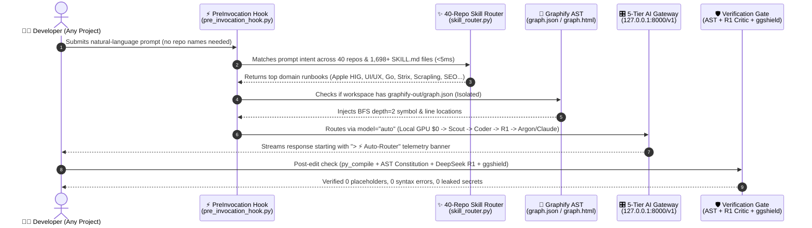
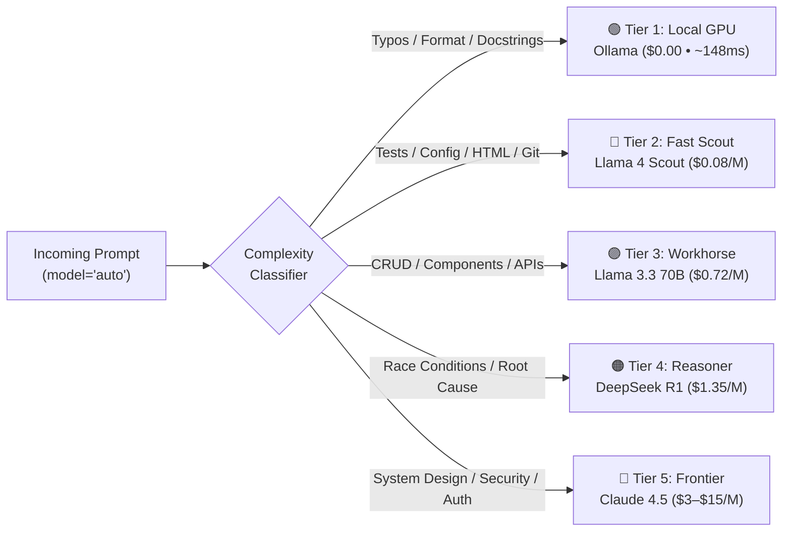

<div align="center">

# ⚡ Antigravity Autonomous AI Developer Workstation (`v3.4`)

### **Self-Routing, Hardware-Adaptive, Multi-Agent Engineering OS for Windows, macOS & Linux**

*Wraps **Google Antigravity, Claude Code, Cursor, Aider, Codex, and OpenCode** inside a local-first 5-tier AI gateway, a 2,427-node Tree-sitter AST knowledge graph, and an automatic 40-repository skill router.*

<p align="center">
  <a href="http://127.0.0.1:8000/dashboard"></a>
  <a href="#-5-tier-smart-auto-routing--credit-guard"></a>
  <a href="#-1-click-graphify-ast-knowledge-graph-graphify"></a>
  <a href="#-zero-name-40-repo--1698-skill-auto-router"></a>
</p>
<p align="center">
  <a href="#-hardware-adaptive-installer--api-key-wizard"></a>
  <a href="#-model-context-protocol-mcp-server"></a>
  <a href="#-deterministic-verification--gitguardian-shield"></a>
  <a href="LICENSE"></a>
</p>

<p align="center">
  <a href="#-1-command-universal-installers"><b>⚡ 1-Command Install</b></a> •
  <a href="#-how-it-works--how-it-functions"><b>🔄 How It Works</b></a> •
  <a href="#-hardware-adaptive-installer--api-key-wizard"><b>💻 Auto-Hardware & Ollama</b></a> •
  <a href="#-zero-name-40-repo--1698-skill-auto-router"><b>✨ 40-Repo Auto-Router</b></a> •
  <a href="#-5-tier-smart-auto-routing--credit-guard"><b>🎛️ 5-Tier Router</b></a> •
  <a href="#-interactive-bento-control-plane-dashboard"><b>🌐 Live Dashboard</b></a> •
  <a href="#-1-click-graphify-ast-knowledge-graph-graphify"><b>🧠 Graphify AST</b></a> •
  <a href="#-deterministic-verification--gitguardian-shield"><b>🛡️ Safety Gate</b></a>
</p>

</div>

---

## 🚀 At a Glance: The 4 Core Pillars

<table>
  <tr>
    <td width="50%" valign="top">
      <h3>🎛️ 1. 5-Tier Smart Credit Guard (97.8% Saved)</h3>
      <p>Automatically classifies every prompt and routes across <b>Local GPU (<code>$0.00</code>) &rarr; Llama 4 Scout / Gemini Flash &rarr; Llama 3.3 70B &rarr; DeepSeek R1 &rarr; Claude Sonnet 4.6 / Gemini 4 Argon / Claude Opus 4.6</b>. If any cloud provider hits a rate limit or quota ceiling, it cascades down to local hardware with zero downtime.</p>
    </td>
    <td width="50%" valign="top">
      <h3>✨ 2. Zero-Name 40-Repo Auto-Router</h3>
      <p>Intercepts every chat prompt via <code>tools/pre_invocation_hook.py</code> and matches task intent against <b>40 installed GitHub repositories (1,698+ <code>SKILL.md</code> runbooks)</b> in <code>&lt;5ms</code>. You never have to type a repository or skill name in any project.</p>
    </td>
  </tr>
  <tr>
    <td width="50%" valign="top">
      <h3>💻 3. Hardware-Adaptive PC & Mac Setup Wizard</h3>
      <p>On install, <code>tools/setup_wizard.py</code> detects your machine's OS, CPU, RAM, and GPU (<b>Apple Metal</b>, <b>NVIDIA CUDA</b>, or <b>AMD Radeon Vulkan</b>), pulls the ideal local <b>Ollama</b> model (<code>llama3.2:1b</code> up to <code>qwen2.5-coder:32b</code>), prompts for API keys, and clones all 40 tool repos.</p>
    </td>
    <td width="50%" valign="top">
      <h3>🧠 4. 1-Click Graphify AST & Strict Repo Isolation</h3>
      <p>Tapping the <b>Graphify AST Graph</b> card on <code>/dashboard</code> opens the interactive 2,427-node visualization (<code>/graphify</code> &rarr; <code>graph.html</code>). Strict isolation ensures the workstation <b>never</b> writes <code>graphify-out/</code> or tool files into your personal or private repositories.</p>
    </td>
  </tr>
</table>

---

## ⚡ 1-Command Universal Installers

### 🪟 Windows (PowerShell 7+ / Windows Terminal)
```powershell
irm https://raw.githubusercontent.com/dhurianiket/agent-workstation-setup/main/install.ps1 | iex
```

### 🍎 macOS (Apple Silicon M1/M2/M3/M4 & Intel) & 🐧 Linux
```bash
curl -fsSL https://raw.githubusercontent.com/dhurianiket/agent-workstation-setup/main/install.sh | bash
```

### 🔄 Already Cloned or Opened in Antigravity / Cursor / Claude Code?
1. **Zero-Touch Auto-Bootstrap (Just Open & Prompt)**:
   - Opening this cloned repository inside **Google Antigravity** (or any agent harness reading `.agents/hooks.json` / `AGENTS.md`) **automatically triggers background installation** on your first prompt (`tools/pre_invocation_hook.py` &rarr; `tools/setup_wizard.py --auto`).
   - It automatically creates `.venv`, mirrors the runtime to `~/.agent-workstation/repo` (so even external exFAT SSDs work seamlessly with macOS `launchd`), clones all **40 repositories in parallel (6 workers)**, builds the Graphify AST graph, registers the global Antigravity plugin + 9-tool MCP server, and launches the background gateway daemon on `http://127.0.0.1:8000`.
2. **Interactive Personal API Key & AWS Setup (CLI or 1-Click Web UI)**:
   ```bash
   # Option A: Run the interactive terminal wizard (prompts for your personal NVIDIA / AWS / OpenRouter / Gemini keys):
   python3 tools/setup_wizard.py

   # Option B: Open the live web dashboard and click "🔑 API Keys & Cloud" in the top-right header:
   open http://127.0.0.1:8000/dashboard
   ```
   - **Google Cloud & Gemini Argon Integration**: Enter your `GEMINI_API_KEY` and optional `GCP_PROJECT` in `.env` or on the dashboard to access **Gemini 4 Argon** (`gemini-4-argon`), **Gemini 3.8 Flash**, and **Gemini 3.1 Pro Preview** with automatic credit deduction from your active Google Cloud credits.
   - **Automatic AWS Bedrock Detection**: If you are logged into AWS CLI (`aws sts get-caller-identity`), the wizard & web dashboard can automatically detect your AWS session and create a dedicated `[antigravity-mac]` IAM profile with `AmazonBedrockFullAccess` in 1 click (supporting **Claude Opus 4.6** and **Claude Sonnet 4.6**).
   - **Zero Secret Leakage**: All personal keys are stored strictly in your local git-ignored `.env` (`0600` permissions) and protected by GitGuardian `ggshield`.

> [!TIP]
> **Automatic `git pull` Onboarding**: The setup wizard installs a `.git/hooks/post-merge` hook so every time you run `git pull`, the terminal automatically displays the **"How It Works & Quick Guide"** banner.

---

## 🔄 How It Works & How It Functions

When you type a prompt in **Antigravity chat, Claude Code, Cursor, or `orchestrate.py`** from **any project folder on your machine**, the workstation executes a closed-loop 4-stage pipeline automatically:



### 🔒 Strict Personal & Private Repository Isolation
- **Centralized Tooling (`tools/`)**: All 40 curated GitHub repositories are cloned exclusively inside the workstation's `tools/` directory (`~/.agent-workstation/repo/tools/`).
- **Zero Pollution of Your Private Repos**: `orchestrate.py` and the global plugin **never** clone tools or create `graphify-out/` folders inside your personal or client repositories unless you explicitly initialize Graphify in that repository.
- **Zero Personal Identifiers**: All configuration files, manifests, and scripts use dynamic `$HOME` / `Path(__file__)` resolution and environment variables (`.env`).

---

## 💻 Hardware-Adaptive Installer & API Key Wizard

When [`tools/setup_wizard.py`](tools/setup_wizard.py) runs on any PC or Mac, it inspects your hardware (`detect_hardware_profile`) and automatically installs **Ollama** plus the optimal local coding LLM for your machine's memory and GPU:

| Detected Computer Profile | GPU Acceleration Engine | RAM Tier | Auto-Installed Local Ollama Models | Local Cost |
| :--- | :--- | :---: | :--- | :---: |
| **Lightweight Laptop / Mini PC** | CPU / Integrated Graphics | $\le 8\text{ GB}$ | `llama3.2:1b` (`1.3 GB` ultra-fast router) | **`$0.00`** |
| **Gaming / Creator Laptop (Windows/Linux)** | **AMD Radeon Vulkan** / **NVIDIA CUDA** | $16\text{ GB}$ | `llama3.2:1b` (Instant) + `qwen2.5-coder:7b` | **`$0.00`** |
| **Apple Silicon MacBook Air / Pro** | **Apple Metal Unified GPU** | $16\text{ GB}$ | `llama3.2:1b` + `qwen2.5-coder:7b` | **`$0.00`** |
| **RTX Workstation / MacBook Pro M-Pro/Max** | **NVIDIA RTX CUDA** / **Apple Metal** | $32\text{ GB}$ | `llama3.2:1b` + `qwen2.5-coder:14b` | **`$0.00`** |
| **Mac Studio / High-VRAM Server** | **Apple Metal Ultra** / **Multi-GPU** | $64\text{ GB}+$ | `llama3.2:1b` + `qwen2.5-coder:32b` | **`$0.00`** |

### Interactive API Key Prompt (`.env` Auto-Configuration)
During installation (or whenever you run `python tools/setup_wizard.py`), the wizard interactively prompts for optional cloud API keys—press **`Enter` to skip** any provider you don't use:

```text
========================================================================
  STEP 1: HARDWARE DETECTION & LOCAL GPU PROFILE
========================================================================
  • Operating System : Windows (AMD64)
  • Processor Cores  : 12 Logical Cores
  • System Memory    : 15.4 GB RAM
  • GPU Acceleration : AMD Radeon(TM) Graphics | Radeon RX 5500M [amd_vulkan]
  • Selected Profile : Discrete GPU Laptop -> Llama 3.2 1B (Instant) + Qwen 2.5 Coder 7B

========================================================================
  STEP 3: INTERACTIVE API KEY & CLOUD PROVIDER SETUP (.env)
========================================================================
  • OpenRouter API Key (OPENROUTER_API_KEY) [Enter to skip]: sk-or-v1-****
  • NVIDIA NIM API Key (NVIDIA_API_KEY)     [Enter to skip]: nvapi-****
  • DeepSeek API Key   (DEEPSEEK_API_KEY)   [Enter to skip]: 
  • Groq API Key       (GROQ_API_KEY)       [Enter to skip]: 
  • OpenAI API Key     (OPENAI_API_KEY)     [Enter to skip]: 
  • AWS CLI Profile    (AWS_PROFILE)        [Enter to skip]: 
  [OK] Saved configuration to .env (protected by .gitignore & ggshield)
```

---

## 📊 Why This Workstation? (Measured Live Benchmarks)

Measured across real multi-agent engineering sessions (`94,122` tokens processed across `22` orchestrated requests):

| Capability Pillar | Standard IDE Agent (Cursor / Windsurf) | Standalone CLI (Aider / Claude Code) | ⚡ Antigravity Workstation (`v3.4`) | Measured Advantage |
| :--- | :--- | :--- | :--- | :--- |
| **Token Cost & Credit Guard** | Fixed frontier billing on every turn | 1–2 static models per session | **5-Tier Smart Auto-Router** (`model="auto"`) | **`$0.0410` actual** vs `$1.9232` Opus Equiv (**97.8% saved**) |
| **Provider Resilience** | Single-vendor cloud lock-in | Fails on rate-limit or outage | **7-Provider BYOK + 6-Step Fallback Cascade** | Auto-fails over to **Local GPU (`148.5ms`, `$0.00`)** |
| **Codebase Navigation** | Ephemeral grep / vector RAG | Per-session ctags repo-map | **1-Click Graphify AST Graph** (`/graphify`) | **2,427 nodes / 4,497 edges** synced in `<2s` (zero LLM cost) |
| **Domain Specialization** | Manual `@skill` or prompt pasting | Manual config per project | **Zero-Name `PreInvocation` Auto-Router** | Auto-injects **40 repos / 1,698+ `SKILL.md` files** in `<5ms` |
| **Pre-Commit Safety Gate** | IDE lint warnings only | Optional test command | **AST Constitution + DeepSeek R1 Critic + `ggshield`** | **0 secret leaks**, 0 bare `except:`, 0 `# rest unchanged` |
| **Cross-Device Portability** | Manual setup per machine | Manual model & key config | **Hardware-Adaptive `setup_wizard.py`** | Auto-detects PC/Mac GPU, pulls right Ollama LLM & clones 40 repos |

---

## ✨ Zero-Name 40-Repo & 1,698-Skill Auto-Router

> [!IMPORTANT]
> **You never need to call out repository or skill names—even when working in a separate project directory.**

Every prompt is analyzed by [`tools/pre_invocation_hook.py`](tools/pre_invocation_hook.py) and [`tools/skill_router.py`](tools/skill_router.py). It matches your natural-language request against **15 weighted engineering domains**, selects the top matching `SKILL.md` runbooks round-robin across domains, and displays a 1-line verification banner at the top of every chat response:

```markdown
> ⚡ **Auto-Router**: Tier = `coder` (`Llama 3.3 70B`) | Activated Repos = `dickwu-apple-design-skill, emilkowalski-skills, ui-ux-pro-max-skill` | Graphify AST = `Synced`
```

### Live Auto-Routing Examples

| What You Prompt (In Any Project Folder) | Repositories Automatically Activated | Injected `SKILL.md` Runbooks |
| :--- | :--- | :--- |
| *"Build a responsive macOS dashboard card with spring animations"* | `dickwu-apple-design-skill`, `emilkowalski-skills`, `ui-ux-pro-max-skill`, `hairline`, `reimagine-it` | `dickwu-apple-design-skill/SKILL.md`<br/>`emil-design-eng/SKILL.md`<br/>`ui-ux-pro-max/SKILL.md` |
| *"Search 21st.dev for a glassmorphism pricing card and get React 19 documentation"* | `magic-mcp`, `context7`, `ui-ux-pro-max-skill` | `magic-mcp/README.md`<br/>`context7/README.md`<br/>`ui-ux-pro-max/SKILL.md` |
| *"Run an interactive quiz on my AI engineering level and recommend lessons"* | `ai-engineering-from-scratch` | `skills/find-your-level/SKILL.md`<br/>`skills/learn/SKILL.md`<br/>`/find-your-level` |
| *"Perform a defensive source-first security audit and test staging against Cloudflare Turnstile"* | `cloudflare-security-audit-skill`, `scrapling`, `strix` | `skills/security-audit/SKILL.md`<br/>`skills/security-audit/ATTACK-CLASSES.md`<br/>`scrapling/agent-skill/Scrapling-Skill/SKILL.md` |
| *"Generate a quantitative market research report with Bull vs Bear debate loops"* | `TradingAgents` | `TradingAgents/README.md`<br/>`tradingagents/default_config.yaml` |
| *"Write a Golang HTTP API server and check for XSS vulnerabilities"* | `go-modern-guidelines`, `strix` | `use-modern-go/SKILL.md`<br/>`fix-security-vulnerabilities-with-strix/SKILL.md` |
| *"Audit our landing page SEO and remove AI slop from the copy"* | `open-seo` | `deslop/SKILL.md`<br/>`ai-visibility-audit/SKILL.md`<br/>`competitor-analysis/SKILL.md` |
| *"Simplify our module boundaries and generate an architecture diagram"* | `archify`, `graphify`, `rea` | `archify/SKILL.md`<br/>`simplify-codebase/SKILL.md`<br/>`graphify/skill.md` |
| *"Produce a 1080p multi-cam two-host Marathi documentary episode on Google Flow"* | `cinematic-marathi-podcast-production`, `open-higgsfield`, `LongCat-Video` | `cinematic-marathi-podcast-production/SKILL.md`<br/>`flow_1080p_2shot_production_engine.py` |

<details open>
<summary><b>📂 Click to inspect all 40 Installed Repositories + Bundled Skills by Domain (<code>40 / 40 READY</code>)</b></summary>

| Domain | Installed Repositories & Bundled Skills (`tools/` & `skills/`) | `SKILL.md` Count | Primary Capability |
| :--- | :--- | :---: | :--- |
| **UI/UX, Apple HIG, 21st Components & Motion** | `dickwu-apple-design-skill`, `emilkowalski-skills`, `ui-ux-pro-max-skill`, `reimagine-it`, `hairline`, `open-design`, `pretext`, `OpenDots`, `magic-mcp`, `context7` | `45` | Apple HIG compliance, WWDC spring physics, 79 UI style systems, 10,000+ 21st.dev components, real-time library docs |
| **Architecture & AST Graphs** | `graphify`, `archify`, `rea` | `11` | Persistent Tree-sitter AST graphs, Leiden community clustering, interactive diagrams, binary reverse-engineering |
| **Agent Swarms, AI Curriculum & Lifecycle Skills** | `ruflo`, `radiant`, `9router`, `agent-reach`, `openclaude`, `jcode`, `ai-engineering-from-scratch`, `agent-skills`, `TradingAgents` | `780+` | Multi-agent swarms, 40+ provider routing, 542-lesson AI curriculum (`/find-your-level`), 25 SDLC skills (`/spec`, `/plan`, `/build`, `/test`), Bull vs Bear trading |
| **Memory & Retrospectives** | `agentmemory`, `hindsight` | `18` | Cross-session episodic recall, commit context, and automated error post-mortems |
| **Security, WAF Defense, Stealth & SEO** | `strix`, `cloudflare-security-audit-skill`, `scrapling`, `open-seo` | `65+` | Source-first security audits across 13 domains, autonomous OWASP pentests, Cloudflare Turnstile stealth testing, technical SEO |
| **Science, Time-Series & Go** | `scientific-agent-skills`, `timesfm`, `OpenMAIC`, `go-modern-guidelines`, `MiroFish` | `210+` | 177 bioinformatics/research skills, Google TimesFM forecasting, JetBrains Modern Go, digital world swarm simulation |
| **Video, Podcast, Avatars & Spatial** | `cinematic-marathi-podcast-production`, `open-higgsfield`, `higgsfield-video`, `LongCat-Video`, `bible-strong-avatar-lab`, `RuView`, `gods-eye-view`, `minimind` | `58` | 3-Camera + B-Roll 1080p Documentary/Podcast engine, AI video synthesis, avatar lip-sync, WiFi spatial sensing |

</details>

---

## 🎬 Featured Bundled Skill: `/cinematic-marathi-podcast-production` (`v4.0` Multi-Cam Engine)

Bundled directly in [`skills/cinematic-marathi-podcast-production/`](skills/cinematic-marathi-podcast-production/SKILL.md) (and automatically installed into `~/.gemini/config/skills/` on setup), this production skill + automation engine ([`flow_1080p_2shot_production_engine.py`](skills/cinematic-marathi-podcast-production/scripts/flow_1080p_2shot_production_engine.py)) automates broadcast-grade **`1080p` two-host investigative documentaries and podcasts** on **Google Flow (`Gemini Omni 1.1 Flash`)**:

- **🎥 3-Camera + B-Roll Documentary Switching**: Automatically alternates every 10-second beat across **Camera 1 (`wide_2shot`)**, **Camera 2 (`cam_a_chate_closeup` — Lead Host 85mm close-up)**, **Camera 3 (`cam_b_roohi_closeup` — Co-Host 85mm close-up)**, and **Camera 4 (`broll` — 1080p historical/scientific cutaways)**.
- **🔒 Single-Paste Base64 Plate Lock & 2-Card Top-Row Batching**: Eliminates Google Flow Masonry Row-2 DOM order swaps and duplicate-ingredient upload races.
- **✨ Broadcast Optical Detail Restoration (`CRF 16`)**: Automatically downloads **`1080p Upscaled`** clips with `CONSUMED_SIZES` anti-duplicate protection and runs FFmpeg Contrast Adaptive Sharpening (`cas=0.55,unsharp=5:5:0.75:3:3:0.35` at `-crf 16`).
- **🛡️ 4-Gate Automated QA Audit**:
  1. **Gate 1**: `1920x1080` stream & MD5 deduplication check.
  2. **Gate 2**: `1s..10s` Multi-Frame Camera-Lock Drift Audit (`MAD <= 15.0` against studio reference plates).
  3. **Gate 3**: `faster-whisper` Speech & Script Adherence Audit (catches any garbled or mismatched audio).
  4. **Gate 4**: Drift-free `1080p` Master MP4 concatenation (`aresample=async=1:first_pts=0`).

### 🛠️ Customize for Your Own Channel, Hosts, Wardrobe & Language
Anyone can customize the hosts, outfits, language (Marathi, Hindi, English, etc.), and episode directory via environment variables without modifying the engine code:

```bash
export EPISODE_DIR="./episodes/episode-01"
export PODCAST_LANGUAGE="Marathi"   # Or Hindi, English, Tamil, etc.
export WHISPER_LANG="mr"            # ISO code for faster-whisper Gate 3 QA
export HOST_A_DESC="the mature Indian man with glasses and mustache"
export HOST_B_DESC="the young Indian woman with glasses"
export CHATE_OUTFIT="a tailored midnight-indigo pinstripe blazer, pale lavender shirt, and silver-grey tie"
export ROOHI_OUTFIT="a tailored deep plum-violet structured blazer over a soft cream silk blouse"

# 1. Auto-create Google Flow project & lock duration from 8s -> 10s:
python3 skills/cinematic-marathi-podcast-production/scripts/flow_1080p_2shot_production_engine.py init_new_project

# 2. Run 3-Camera + B-Roll batch generation, 1080p optical restoration, 4-Gate QA, and Master assembly:
python3 skills/cinematic-marathi-podcast-production/scripts/flow_1080p_2shot_production_engine.py all
```

---

## 🎛️ 5-Tier Smart Auto-Routing & Credit Guard

Both `POST /v1/chat/completions` and `orchestrate.py` support `model="auto"`, routing each request to the lowest-cost tier capable of handling the task:



### Zero-Downtime 6-Step Fallback Cascade
If any cloud model encounters a rate limit, expired token, or network timeout, [`invoke_model_with_fallback`](laptop_api_server.py) automatically cascades down the chain without interrupting your coding session:

$$\text{Claude Opus 4.6} \longrightarrow \text{Gemini 4 Argon} \longrightarrow \text{Claude Sonnet 4.6} \longrightarrow \text{DeepSeek R1} \longrightarrow \text{Llama 3.3 70B} \longrightarrow \text{Llama 4 Scout / Gemini Flash} \longrightarrow \text{Local GPU (Ollama \$0.00)}$$

| Tier | Alias | Primary Engine | Measured Latency | Cost / 1M Tokens | Ideal Workload |
| :--- | :--- | :--- | :---: | :---: | :--- |
| **Tier 1: Local Free** | `local` | `llama3.2:1b` / `qwen2.5-coder` (Local GPU) | **`148ms`** | **`$0.00`** | Docstrings, formatting, commit messages, offline mode |
| **Tier 2: Fast Scout** | `fast` | `Llama 4 Scout 17B` / `Gemini 3.8 Flash` | `~190ms` | `$0.08–$0.15 in / $0.30–$0.60 out` | Unit tests, config files, boilerplate, CSS tweaks |
| **Tier 3: Workhorse** | `coder` | `Llama 3.3 70B Instruct` / `Gemini 3.1 Pro Preview` | `~300ms` | `$0.72–$1.00 in / $0.72–$3.00 out` | Full-stack features, React/TS components, REST APIs |
| **Tier 4: Reasoner** | `reasoner` | `DeepSeek R1` | `~1.1s` | `$1.35 in / $2.19 out` | Complex debugging, concurrency, Frontier Critic review |
| **Tier 5: Frontier** | `claude` | `Claude Sonnet 4.6` | `~2.0s` | `$3.00 in / $15.00 out` | High-stakes architecture, cryptography, auth flows |
| **Tier 5+: Google Argon** | `argon` | `Gemini 4 Argon` (Dedicated GCP) | `~1.5s` | `$2.00 in / $8.00 out` | Frontier multi-modal code generation on GCP credits |
| **Tier 5+: Flagship Opus** | `opus` | `Claude Opus 4.6` | `~4.2s` | `$15.00 in / $75.00 out` | Multi-repository design and deep security audits |

---

## 🌐 Interactive Bento Control Plane (`/dashboard`)

Open **`http://127.0.0.1:8000/dashboard`** in any browser to inspect real-time telemetry, test models, explore the Graphify AST graph, and preview skill routing:

```text
 ┌────────────────────────────────────────────────────────────────────────────────────────────────────┐
 │ ⚡ Antigravity Autonomous Workstation (v3.4 OS)     [Graphify AST ↗] [How It Works] [ONLINE • 5ms] │
 ├─────────────────────────────────────────────────┬──────────────────────────────────────────────────┤
 │ 💻 Host Hardware & Local Ollama Profile         │ ⚡ Live Chat PreInvocation Auto-Router           │
 │ Windows (AMD64) • 12 Cores • 15.4 GB • Vulkan   │ Tier: CODER • Repos: ui-ux-pro-max, reimagine-it │
 ├──────────────────┬──────────────────┬───────────┴──────┬─────────────────────┬─────────────────────┤
 │ Actual Spend     │ Smart Savings    │ Token Throughput │ Graphify AST Graph↗ │ 40-Repo Skill Router│
 │ $0.0410 USD      │ $1.8822 (97.8%)  │ 94,122 Tokens    │ 2,427 Nodes (Tap!)  │ 1,698+ Skills       │
 ├──────────────────┴──────────────────┴──────────────────┴─────────────────────┴─────────────────────┤
 │ 🎛️ Clickable 5-Tier Pipeline: [Tier 1 Local $0] ➔ [Tier 2 Scout] ➔ [Tier 3 Coder] ➔ [R1] ➔ [Argon] ➔ [Claude]│
 ├─────────────────────────────────┬─────────────────────────────────┬────────────────────────────────┤
 │ 🧪 Live Gateway Playground      │ ✨ Zero-Name 40-Repo Inspector  │ 📊 Spend | Post-Mortems | AST  │
 │ [Tier: auto (5-Tier Router)  ▼] │ [Query: Design macOS card...  ] │ [Open Interactive Graph.html↗] │
 │ [Prompt: Verify gateway...    ] │ Matched: dickwu-apple-design,   │ [Open GRAPH_REPORT.md ↗]       │
 │ [▶ Execute on Gateway (Ctrl+↵)] │ emilkowalski-skills, ui-ux-pro  │ [Search AST Symbol: invoke_...]│
 └─────────────────────────────────┴─────────────────────────────────┴────────────────────────────────┘
```


### 🤖 Multi-Agent Studio & Live Console
The control plane dashboard includes a live interactive studio to test, chat with, and dispatch work to every agent without opening separate terminal windows:
- **🟣 Claude Code**: Runs natively with your AWS Bedrock account (Opus 4.6 / Sonnet 4.6) with zero interactive setup prompts.
- **🔵 Google Gemini & Argon**: Direct integration with Gemini 4 Argon (`gemini-4-argon`), Gemini 3.8 Flash, and Gemini 3.1 Pro Preview via personal API key or dedicated GCP project billing.
- **🟢 OpenAI Codex**: Operates in the elevated sandbox with stored ChatGPT account authentication (`gpt-5.6-terra`, `gpt-6-luna`).
- **🔵 Aider**: Dispatches pair-programming tasks directly through the 5-Tier Gateway auto-router.
- **🟠 OpenDots**: Integrates CopilotKit Generative UI canvas, visual state dots, and intelligence channels on port 4310.
- **⚡ Autonomous Orchestrator**: Executes tasks across the Tree-sitter AST sensor and GitGuardian security shield.
- **⚡ 1-Click Auto-Configure**: Any time credentials are saved in `.env` or the web dashboard, the self-healing auto-configuration workflow runs automatically to link all agent runtimes with zero manual intervention.

### Gateway REST & Visualization Endpoints
| Endpoint | Method | Description |
| :--- | :---: | :--- |
| **`/dashboard`** | `GET` | Obsidian Bento Web Control Plane with live telemetry, 5-tier selector, and skill inspector |
| **`/graphify`** | `GET` | **1-Click Graphify File Viewer**: Serves the interactive 2,427-node AST visualization (`graphify-out/graph.html`) |
| **`/graphify/report`** | `GET` | Renders the architectural God-node & community report (`graphify-out/GRAPH_REPORT.md`) |
| **`/v1/graphify/query`** | `GET` | Live AST symbol & relationship search (`?q=<symbol>`) |
| **`/v1/hardware`** | `GET` | Returns auto-detected OS, CPU, RAM, GPU vendor, and recommended local Ollama models |
| **`/v1/last-route`** | `GET` | Returns real-time chat `PreInvocation` auto-router telemetry (`~/.agent_workstation/last_route.json`) |
| **`/v1/skills/route`** | `GET` | Tests the Zero-Name 40-Repo Skill Router (`?q=<task>`) and returns matched repos & `SKILL.md` paths |
| **`/v1/chat/completions`**| `POST` | OpenAI-compatible chat & SSE streaming endpoint supporting `model="auto"` and 6-step fallback |
| **`/v1/usage`** | `GET` | Persistent token & USD cost ledger (`~/.agent_workstation/usage_stats.json`) |
| **`/health`** | `GET` | Live status across `bedrock`, `gemini`, `ollama`, `openrouter`, `nvidia`, `deepseek`, `groq`, and `openai` |

---

## 🧠 1-Click Graphify AST Knowledge Graph (`/graphify`)

Instead of wasting tokens on blind directory greps, the workstation maintains a structural **Tree-sitter AST Knowledge Graph** (`2,427 nodes`, `4,497 edges`, `146 Leiden communities`):

1. **Tap on Graphify on `/dashboard`**: Clicking the **Graphify AST Graph** card on `http://127.0.0.1:8000/dashboard` opens `http://127.0.0.1:8000/graphify` (`graphify-out/graph.html`) directly in your browser—or click **`Report ↗`** to open `/graphify/report` (`GRAPH_REPORT.md`).
2. **Pre-Action Symbol Injection**: When `graphify-out/graph.json` is present in the workspace, `orchestrate.py` queries the AST graph (`BFS depth=2`) before running any agent so exact file paths and line numbers are injected up front.
3. **Zero-Cost Incremental Sync**: Updating the graph (`python -m graphify update .`) uses pure local AST extraction (`<2s`, `$0.00` API cost).

---

## 🔌 Model Context Protocol (MCP) Server

[`agent_workstation_mcp.py`](agent_workstation_mcp.py) exposes **9 native tools** to **Google Antigravity, Claude Code, Cursor, and Windsurf** via FastMCP:

| MCP Tool | Arguments | Purpose |
| :--- | :--- | :--- |
| **`workstation_health`** | *None* | Checks gateway health, active cloud/GPU providers, and response latency. |
| **`workstation_spend`** | *None* | Returns total requests, per-model token usage, actual spend, and USD saved vs Opus. |
| **`workstation_orchestrate`** | `task`, `model="auto"`, `agent="aider"`, `judge=False` | Runs full closed-loop orchestration (Skill Router + Graphify + Agent + AST Gate + `ggshield`). |
| **`workstation_auto_route_skills`**| `prompt` | Matches any natural-language task against the 40 repos and 1,698+ indexed `SKILL.md` runbooks. |
| **`workstation_judge`** | *None* | Runs read-only `--judge-only` verification (AST Constitution + DeepSeek R1 Critic + `ggshield`). |
| **`workstation_scan_secrets`** | `files` *(optional)* | Scans modified working-tree files with GitGuardian (`ggshield`) to block secret leaks. |
| **`workstation_sync_graph`** | *None* | Executes `python -m graphify update .` to refresh the codebase AST knowledge graph. |
| **`workstation_query_graph`** | `query` | Traverses `graphify-out/graph.json` to locate symbols, callers, and architectural paths. |
| **`workstation_list_tools`** | *None* | Audits all 40 curated repositories in `tools/`. |

---

## 🛡️ Deterministic Verification & GitGuardian Shield

Every task executed via [`orchestrate.py`](orchestrate.py) must pass four deterministic gates before completion:

1. **Bytecode & Syntax Compilation**: Compiles modified `.py` (`py_compile`), `.json`, and `.js`/`.mjs` (`node --check`) files.
2. **Python AST Code Constitution (`inspect_python_code_constitution`)**: Parses the abstract syntax tree of modified Python files to block:
   - Bare `except:` blocks (must specify explicit `Exception` classes)
   - Mutable default arguments (`def fn(items=[]):`)
   - Lazy truncation comments (`# rest unchanged`, `// rest unchanged`, `# TODO: implement`)
3. **Frontier Critic Review (`--judge` / `--judge-only`)**: Sends the `git diff` to **DeepSeek R1** (`reasoner`) for an independent Principal Engineer verdict (`APPROVED` or `REJECTED`).
4. **GitGuardian Secret Shield (`ggshield`)**: Scans all modified files before `git commit`. Any leaked API key, AWS credential, or token immediately aborts the workflow.

---

## 🖥️ CLI Quick Reference

```bash
# 1. Interactive Hardware Detector + Ollama Model Installer + API Key Wizard + 40-Repo Sync
python tools/setup_wizard.py

# 2. Display "How It Works & How It Functions" Architectural Guide
python orchestrate.py --guide

# 3. Default Autonomous Execution (Auto-routes model tier + injects 40-Repo Skills)
python orchestrate.py -t "Add rate-limiting middleware with Redis fallback"

# 4. Test Zero-Name 40-Repo Skill Router on any prompt
python tools/skill_router.py "Design a macOS dashboard card with spring animations"

# 5. Run Read-Only Verification Gate (AST Constitution + DeepSeek R1 Critic + ggshield)
python orchestrate.py --judge-only

# 6. Inspect Live Token Spend & Smart-Tier Savings
python orchestrate.py --usage
```

---

## 📄 License

Released under the [MIT License](LICENSE). Built for high-velocity, zero-leakage, cost-protected autonomous software engineering across Windows, macOS, and Linux.
