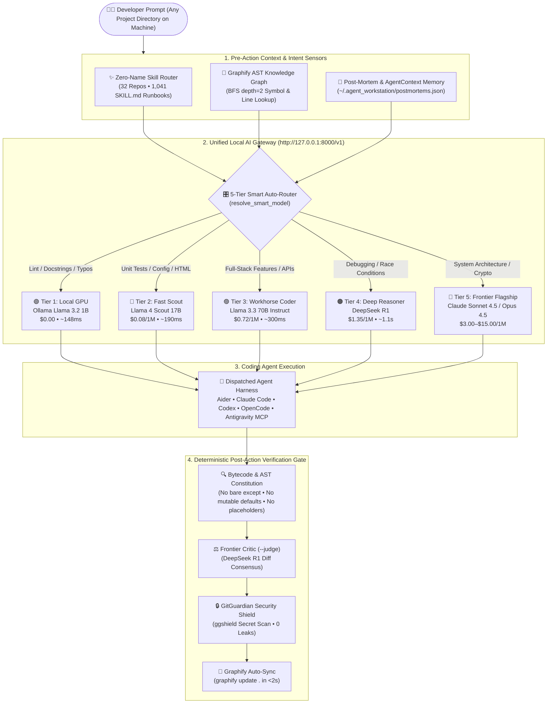
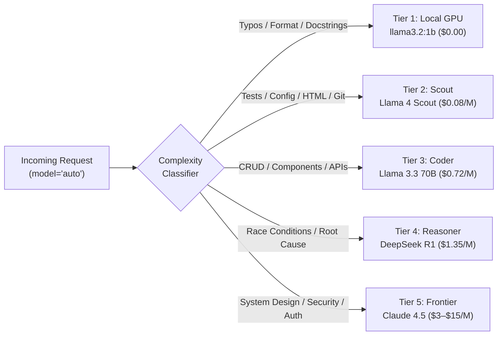

<div align="center">

# ⚡ Antigravity Autonomous AI Developer Workstation OS (`v3.3`)

**Turn any Mac, Windows PC, or Linux machine into a self-verifying, cost-protected, multi-agent engineering OS.**

[](http://127.0.0.1:8000/dashboard)
[](#-5-tier-smart-auto-routing--credit-guard)
[](#-graphify-ast-knowledge-graph--agentcontext)
[](#-zero-name-32-repo--1041-skill-auto-router)
[](#-model-context-protocol-mcp-server)
[](#-deterministic-verification--gitguardian-shield)
[](#-dockerized-sandbox-execution)
[](LICENSE)

<p align="center">
  <a href="#-1-command-universal-installers"><b>Quick Start</b></a> •
  <a href="#-system-architecture"><b>Architecture</b></a> •
  <a href="#-why-this-workstation-live-benchmarks"><b>Benchmarks</b></a> •
  <a href="#-5-tier-smart-auto-routing--credit-guard"><b>5-Tier Router</b></a> •
  <a href="#-zero-name-32-repo--1041-skill-auto-router"><b>32-Repo Auto-Router</b></a> •
  <a href="#-graphify-ast-knowledge-graph--agentcontext"><b>Graphify AST</b></a> •
  <a href="#-interactive-web--telemetry-dashboard"><b>Dashboard</b></a> •
  <a href="#-multi-device-hardware--byok-setup"><b>Hardware & BYOK</b></a>
</p>

</div>

---

## 🎯 Overview

Most AI coding setups suffer from three fatal flaws: **runaway frontier API costs** on trivial edits, **blind grep searches** across large repositories, and **unverified code mutations** that leak secrets or break builds.

The **Antigravity Autonomous Workstation** solves all three by wrapping **Aider, Claude Code, Codex, OpenCode, Cursor, and Google Antigravity** inside a unified, local-first control plane:

- **🎛️ 5-Tier Smart Auto-Router**: Dynamically routes prompts across **Local Discrete GPU (`$0.00`) $\rightarrow$ Llama 4 Scout $\rightarrow$ Llama 3.3 70B $\rightarrow$ DeepSeek R1 $\rightarrow$ Claude 4.5 Sonnet/Opus**, cutting token spend by **97.8%**.
- **🧠 Pre-Action Graphify AST Context**: Queries a persistent 2,397-node AST knowledge graph (`graphify-out/graph.json`) before editing code, injecting exact symbol definitions and call-chain locations.
- **✨ Zero-Name 32-Repo Skill Router**: Automatically matches any natural-language prompt in **any project folder on your laptop** against **32 installed tool repositories and 1,041 `SKILL.md` runbooks**—without you ever naming a repo.
- **🛡️ 4-Stage Post-Action Verification Gate**: Enforces Python AST Code Constitution checks, bytecode compilation, **DeepSeek R1 Frontier Critic** diff review, and **GitGuardian (`ggshield`)** zero-leakage secret scanning before any commit.

---

## 📊 Why This Workstation? (Live Benchmarks)

Measured across real multi-agent development sessions (`94,122` total tokens processed across `22` orchestrated requests):

| Capability Pillar | Standard IDE Agent (Cursor / Windsurf) | Standalone CLI (Aider / Claude Code) | ⚡ Antigravity Workstation (`v3.3`) | Measured Advantage |
| :--- | :--- | :--- | :--- | :--- |
| **Token Cost & Credit Guard** | Fixed frontier billing on every turn | 1–2 static models per session | **5-Tier Smart Auto-Router** (`model="auto"`) | **`$0.0410` actual** vs `$1.9232` Frontier Equiv (**97.8% saved**) |
| **Provider Resilience** | Single-vendor cloud lock-in | Fails on rate-limit or outage | **7-Provider BYOK + 6-Step Fallback Cascade** | Auto-fails over to **Local GPU (`148.5ms`, `$0.00`)** |
| **Codebase Navigation** | Ephemeral grep / vector RAG | Per-session ctags repo-map | **Persistent Graphify AST Graph** (`BFS depth=2`) | **2,397 nodes / 4,445 edges** synced in `<2s` (zero LLM cost) |
| **Domain Specialization** | Manual `@skill` or prompt pasting | Manual config per project | **Zero-Name Auto-Router (`tools/skill_router.py`)** | Auto-injects **32 repos / 1,041 `SKILL.md` files** in `<5ms` |
| **Pre-Commit Safety Gate** | IDE lint warnings only | Optional test command | **AST Constitution + DeepSeek R1 Critic + `ggshield`** | **0 secret leaks**, 0 bare `except:`, 0 `# rest unchanged` |
| **Cross-Project Scope** | Per-workspace rules | Per-directory config | **Global Plugin (`~/.gemini`, `~/.claude`, `~/.aider`)** | Automatically active in **every folder on your machine** |

---

## 🏗️ System Architecture



---

## ⚡ 1-Command Universal Installers (Hardware-Adaptive + Interactive Wizard)

When you install or pull this repository on **any Windows PC, Mac (Apple Silicon / Intel), or Linux machine**, the installer automatically runs [`tools/setup_wizard.py`](tools/setup_wizard.py) which performs 6 zero-touch steps:

1. **Auto-Detects Your Computer Hardware (`detect_hardware_profile`)**: Inspects OS, CPU cores, total RAM (GB), and GPU architecture (**Apple Metal Unified Memory**, **NVIDIA CUDA**, **AMD Radeon Vulkan**, or **CPU**).
2. **Installs & Pulls the Optimal Local Ollama Model (`$0.00` Offline Tier)**:
   - **$\le 8\text{GB}$ RAM**: Pulls `llama3.2:1b` (`1.3GB` instant local router)
   - **$16\text{GB}$ RAM (Discrete GPU / Apple Silicon M1–M4)**: Pulls `llama3.2:1b` + `qwen2.5-coder:7b`
   - **$32\text{GB}$ RAM (RTX Workstation / MacBook Pro M-Pro/Max)**: Pulls `llama3.2:1b` + `qwen2.5-coder:14b`
   - **$64\text{GB}+$ RAM (Mac Studio / High-VRAM Server)**: Pulls `llama3.2:1b` + `qwen2.5-coder:32b`
3. **Interactive API Key Setup Wizard**: Prompts you to optionally paste your `OPENROUTER_API_KEY`, `NVIDIA_API_KEY`, `DEEPSEEK_API_KEY`, `GROQ_API_KEY`, `OPENAI_API_KEY`, or `AWS_PROFILE` (press `Enter` to skip any provider and run 100% free on local Ollama GPU) and writes a git-ignored `.env`.
4. **Auto-Clones All 32 GitHub Repositories & Indexes 456+ Skills**: Runs `python tools/manage_tools.py sync` and `python tools/skill_router.py --index` so all 32 curated repositories are installed in `tools/`.
5. **Registers Global Pre-Invocation Auto-Router Hook**: Installs `~/.gemini/config/plugins/antigravity-workstation/hooks.json` (`tools/pre_invocation_hook.py`), `~/.claude/CLAUDE.md`, and `~/.aider.conf.yml` while keeping **100% strict isolation from your personal/private repositories** (never writes workstation or `graphify-out/` files into your personal repos).
6. **Prints the "How It Works & How It Functions" Guide**: Explains every endpoint, tier, and command upon install or `git pull`.

### 🍎 macOS (Apple Silicon M1/M2/M3/M4 & Intel) & 🐧 Linux
```bash
curl -sSL https://raw.githubusercontent.com/dhurianiket/agent-workstation-setup/main/install.sh | bash
```

### 🪟 Windows (PowerShell 7+ / Windows Terminal)
```powershell
irm https://raw.githubusercontent.com/dhurianiket/agent-workstation-setup/main/install.ps1 | iex
```

### 🔄 Already Cloned? Run the Interactive Setup or Guide Anytime
```bash
# Run interactive hardware detection + Ollama model installer + API key prompt + 32-repo sync:
python tools/setup_wizard.py

# Print the "How It Works & How It Functions" architectural walkthrough:
python orchestrate.py --guide
```

### 🐳 Docker Sandbox (Isolated Multi-Platform Container)
```bash
git clone https://github.com/dhurianiket/agent-workstation-setup.git
cd agent-workstation-setup
cp .env.example .env
docker compose up -d
```

---

## ✨ Zero-Name 32-Repo & 1,041-Skill Auto-Router

> [!IMPORTANT]
> **You never need to type a repository or skill name—even when working in a brand-new project directory.**

All **32 curated developer repositories** (containing **1,041 `SKILL.md` files** and **456 indexed runbooks**) are centrally installed in `tools/` and indexed by [`tools/skill_router.py`](tools/skill_router.py). Whenever you submit a prompt from **any directory on your laptop**, the router inspects your prompt's intent in `<5ms`, selects the top matching domain runbooks (round-robin across matched domains), and injects their architectural rules automatically.

### Live Auto-Routing Examples

| What You Prompt (In Any Project Folder) | Repositories Automatically Activated | Injected `SKILL.md` Runbooks |
| :--- | :--- | :--- |
| *"Build a responsive macOS dashboard card with spring animations"* | `dickwu-apple-design-skill`, `emilkowalski-skills`, `ui-ux-pro-max-skill`, `hairline`, `reimagine-it` | `dickwu-apple-design-skill/SKILL.md`<br/>`emil-design-eng/SKILL.md`<br/>`ui-ux-pro-max/SKILL.md` |
| *"Write a Golang HTTP API server and check for XSS vulnerabilities"* | `go-modern-guidelines`, `strix` | `use-modern-go/SKILL.md`<br/>`fix-security-vulnerabilities-with-strix/SKILL.md` |
| *"Audit our landing page SEO and remove AI slop from the copy"* | `open-seo` | `deslop/SKILL.md`<br/>`ai-visibility-audit/SKILL.md`<br/>`competitor-analysis/SKILL.md` |
| *"Simplify our module boundaries and generate an architecture diagram"* | `archify`, `graphify`, `rea` | `archify/SKILL.md`<br/>`simplify-codebase/SKILL.md`<br/>`graphify/skill.md` |

### Complete 32-Repository Ecosystem (`32 / 32 READY`)

<details open>
<summary><b>📂 Click to inspect all 32 Installed Repositories by Domain</b></summary>

| Domain | Installed Repositories (`tools/`) | `SKILL.md` Count | Primary Capability |
| :--- | :--- | :---: | :--- |
| **UI/UX, Apple HIG & Motion** | `dickwu-apple-design-skill`, `emilkowalski-skills`, `ui-ux-pro-max-skill`, `reimagine-it`, `hairline`, `open-design`, `pretext`, `OpenDots` | `36` | Apple HIG compliance, WWDC spring physics, 79 UI style systems, DOM-less text layout |
| **Architecture & AST Graphs** | `graphify`, `archify`, `rea` | `11` | Persistent Tree-sitter AST graphs, Leiden community clustering, interactive diagrams |
| **Agent Swarms & Routers** | `ruflo`, `radiant`, `9router`, `agent-reach`, `openclaude`, `jcode` | `666` | Multi-agent swarms, 40+ provider routing, live web/GitHub/X research |
| **Memory & Retrospectives** | `agentmemory`, `hindsight` | `18` | Cross-session episodic recall, commit context, and automated error post-mortems |
| **Security & SEO** | `strix`, `open-seo` | `48` | Autonomous OWASP pentesting & patch validation, technical SEO audits, prose deslop |
| **Science, Time-Series & Go** | `scientific-agent-skills`, `timesfm`, `OpenMAIC`, `go-modern-guidelines` | `205` | 177 bioinformatics/research skills, Google TimesFM forecasting, JetBrains Modern Go |
| **Video, Avatars & Spatial** | `open-higgsfield`, `higgsfield-video`, `LongCat-Video`, `bible-strong-avatar-lab`, `RuView`, `gods-eye-view`, `minimind` | `57` | AI video synthesis, avatar lip-sync, WiFi spatial sensing, 3D telemetry |

</details>

```bash
# Audit all 32 repositories
python tools/manage_tools.py audit

# Test the Zero-Name Skill Router on any prompt
python tools/skill_router.py "Design a glassmorphic iOS sheet with spring physics"
```

---

## 🧠 Graphify AST Knowledge Graph & `AgentContext`

Instead of burning thousands of tokens grepping raw files, the workstation maintains a structural **Tree-sitter AST Knowledge Graph** (`graphify-out/graph.json`) alongside structured execution memory ([`AGENT_CONTEXT.md`](AGENT_CONTEXT.md)):

1. **Pre-Action Symbol Injection (`get_graphify_context`)**: Before dispatching any coding agent, [`orchestrate.py`](orchestrate.py) runs a `BFS depth=2` traversal over `graphify-out/graph.json` and injects the exact file paths and line numbers of relevant functions, classes, and callers.
2. **Auto-Initialization in New Projects**: If you run [`orchestrate.py`](orchestrate.py) inside a new project folder that doesn't have a graph yet, it automatically builds `graphify-out/graph.json` on the fly.
3. **Sub-2-Second Post-Edit Sync**: Every code modification triggers `python -m graphify update .` (pure AST extraction, `$0.00` LLM cost), keeping all **2,397 nodes, 4,445 edges, and 155 communities** synchronized.

---

## 🎛️ 5-Tier Smart Auto-Routing & Credit Guard

Both `/v1/chat/completions` and `orchestrate.py` support `model="auto"` out of the box, delegating tasks to the most cost-effective model tier capable of solving them:



### Zero-Downtime Fallback Cascade
If any cloud model hits a rate limit, quota ceiling, or network timeout, [`invoke_model_with_fallback`](laptop_api_server.py) cascades down the chain automatically without dropping the agent session:

$$\text{Claude Opus 4.5} \longrightarrow \text{Claude Sonnet 4.5} \longrightarrow \text{DeepSeek R1} \longrightarrow \text{Llama 3.3 70B} \longrightarrow \text{Llama 4 Scout} \longrightarrow \text{Local GPU (Ollama \$0.00)}$$

| Tier | Alias | Primary Engine | Measured Latency | Cost / 1M Tokens | Ideal Workload |
| :--- | :--- | :--- | :---: | :---: | :--- |
| **Tier 1: Local Free** | `local` | `llama3.2:1b` (Local GPU) | **`148ms`** | **`$0.00`** | Docstrings, formatting, commit messages, offline mode |
| **Tier 2: Fast Scout** | `fast` | `Llama 4 Scout 17B` | `~190ms` | `$0.08 in / $0.30 out` | Unit tests, config files, boilerplate, CSS tweaks |
| **Tier 3: Workhorse** | `coder` | `Llama 3.3 70B Instruct` | `~300ms` | `$0.72 in / $0.72 out` | Full-stack features, React/TS components, REST APIs |
| **Tier 4: Reasoner** | `reasoner` | `DeepSeek R1` | `~1.1s` | `$1.35 in / $2.19 out` | Complex debugging, concurrency, Frontier Critic review |
| **Tier 5: Frontier** | `claude` | `Claude Sonnet 4.5` | `~2.0s` | `$3.00 in / $15.00 out` | High-stakes architecture, cryptography, auth flows |
| **Tier 5+: Flagship** | `opus` | `Claude Opus 4.5` | `~4.2s` | `$15.00 in / $75.00 out` | Multi-repository design and deep security audits |

---

## 🌐 Interactive Web & Telemetry Dashboard

Open **`http://127.0.0.1:8000/dashboard`** in any browser for real-time observability across your entire AI stack:

```text
 ┌──────────────────────────────────────────────────────────────────────────────────────────┐
 │ ⚡ Antigravity Workstation Control Plane (v2.3)                   HEALTHY • 49ms Latency │
 ├──────────────────┬──────────────────┬──────────────────┬────────────────┬────────────────┤
 │ Total Spend      │ Smart Savings    │ Total Tokens     │ Active Models  │ Graphify AST   │
 │ $0.0410 USD      │ $1.8822 Saved    │ 94,122 Tokens    │ 22 Aliases     │ 2,397 Nodes    │
 ├──────────────────┴──────────────────┴──────────────────┴────────────────┴────────────────┤
 │ ⚡ 5-Tier Pipeline: Local GPU ($0) ➔ Scout ($0.08) ➔ Coder ($0.72) ➔ R1 ➔ Claude 4.5     │
 ├───────────────────────────────────────────┬──────────────────────────────────────────────┤
 │ 🧪 In-Browser Live Prompt Playground      │ 📊 Per-Model Spend & Request Breakdown       │
 │ [Tier: auto (Smart 5-Tier Router)      ▼] │ • llama4-scout-17b   │ 12 reqs │ $0.0077 USD │
 │ [Prompt: Write unit test config check   ] │ • llama3-3-70b       │  5 reqs │ $0.0056 USD │
 │ [▶ Execute on Gateway]                    │ • deepseek.r1-v1     │  2 reqs │ $0.0041 USD │
 │ ➔ Routed: fast (148ms) | Output: "PASS"   │ • llama3.2:1b (GPU)  │  2 reqs │ $0.0000 USD │
 └───────────────────────────────────────────┴──────────────────────────────────────────────┘
```

### Gateway REST Endpoints
- `GET /dashboard` — Interactive real-time telemetry UI, 5-tier selector, 32-repo skill inspector, and prompt playground
- `GET /graphify` — Opens the interactive **Graphify AST Graph** (`graphify-out/graph.html`) when you tap the Graphify card on `/dashboard`
- `GET /graphify/report` — Renders `graphify-out/GRAPH_REPORT.md` in a dark-mode architecture viewer
- `GET /v1/graphify/query?q=<symbol>` — Queries the AST knowledge graph for symbols, callers, and relationships
- `GET /v1/hardware` — Returns auto-detected PC/Mac hardware (OS, CPU, RAM, GPU) and recommended local Ollama models
- `GET /v1/last-route` — Live chat `PreInvocation` auto-router telemetry (`~/.agent_workstation/last_route.json`)
- `GET /health` — Provider status (`bedrock`, `ollama`, `openrouter`, `nvidia`, `deepseek`, `groq`, `openai`)
- `GET /v1/models` — OpenAI-compatible model catalog (`22` aliases including `auto`)
- `POST /v1/chat/completions` — OpenAI-compatible chat & streaming completions with `model="auto"` routing
- `GET /v1/usage` — Persistent token and USD cost ledger (`~/.agent_workstation/usage_stats.json`)
- `GET /v1/graph` — Live Graphify AST node, edge, and Leiden community counts
- `GET /v1/skills/route?q=<prompt>` — Live Zero-Name 32-Repo Skill Router inspection
- `GET /v1/postmortems` — Cross-session failure memory log

---

## 🔌 Model Context Protocol (MCP) Server

[`agent_workstation_mcp.py`](agent_workstation_mcp.py) exposes the workstation natively to **Google Antigravity, Cursor, Windsurf, and Claude Code** via FastMCP.

### Global Registration (`~/.gemini/config/mcp_config.json` or `claude_desktop_config.json`)
```json
{
  "mcpServers": {
    "agent_workstation_mcp": {
      "command": "python",
      "args": ["/absolute/path/to/agent-workstation-setup/agent_workstation_mcp.py"]
    }
  }
}
```

### Available MCP Tools (8 Native Tools)
| MCP Tool | Arguments | What It Does |
| :--- | :--- | :--- |
| **`workstation_health`** | *None* | Checks gateway health, active cloud/GPU providers, and response latency. |
| **`workstation_spend`** | *None* | Returns total requests, per-model token usage, actual spend, and USD saved vs Opus. |
| **`workstation_orchestrate`** | `task`, `model="auto"`, `agent="aider"`, `judge=False` | Runs full closed-loop orchestration (Skill Router + Graphify + Agent + AST Gate + `ggshield`). |
| **`workstation_auto_route_skills`**| `prompt` | Matches any natural-language task against the 32 repos and 456+ indexed `SKILL.md` runbooks. |
| **`workstation_judge`** | *None* | Runs read-only `--judge-only` verification (AST Constitution + DeepSeek R1 Critic + `ggshield`). |
| **`workstation_scan_secrets`** | `files` *(optional)* | Scans modified working-tree files with GitGuardian (`ggshield`) to block secret leaks. |
| **`workstation_sync_graph`** | *None* | Executes `python -m graphify update .` to refresh the codebase AST knowledge graph. |
| **`workstation_query_graph`** | `query` | Traverses `graphify-out/graph.json` to locate symbols, callers, and architectural paths. |
| **`workstation_list_tools`** | *None* | Audits all 32 curated repositories in `tools/`. |

---

## 🔒 Deterministic Verification & GitGuardian Shield

Every task executed via [`orchestrate.py`](orchestrate.py) must pass four deterministic gates before completion:

1. **Bytecode & Syntax Compilation**: Automatically compiles modified `.py` (`py_compile`), `.json`, and `.js`/`.mjs` (`node --check`) files.
2. **Python AST Code Constitution (`inspect_python_code_constitution`)**: Parses the abstract syntax tree of modified Python files to forbid:
   - Bare `except:` blocks (must specify explicit `Exception` classes)
   - Mutable default arguments (`def fn(items=[]):`)
   - Lazy truncation comments (`# rest unchanged`, `// rest unchanged`, `# TODO: implement`)
3. **Frontier Critic Review (`--judge` / `--judge-only`)**: Sends the `git diff` to **DeepSeek R1** (`reasoner`) for an independent Principal Reviewer verdict (`APPROVED` or `REJECTED`).
4. **GitGuardian Secret Shield (`ggshield`)**: Scans modified files prior to commit. Any leaked AWS key, API token, or private certificate immediately aborts the workflow.

---

## 💻 Multi-Device Hardware & BYOK Setup

### 1. Hardware Acceleration by Platform
- **🍎 Apple Silicon (`M1 / M2 / M3 / M4` MacBook Pro, iMac, Mac Studio)**:
  ```bash
  brew install ollama && ollama serve
  ollama pull llama3.2:1b          # 8GB–16GB Unified Memory (instant local tier)
  ollama pull qwen2.5-coder:14b    # 32GB+ Unified Memory
  ```
- **🪟 Windows PC with Discrete GPU (AMD Radeon Vulkan / NVIDIA RTX CUDA)**:
  - Verified on **AMD Radeon RX 5500M** (`148.5ms` local inference) and NVIDIA RTX GPUs.
- **🐧 Linux Workstations**:
  ```bash
  curl -fsSL https://ollama.com/install.sh | sh && ollama run llama3.2:1b
  ```

### 2. Bring Your Own Key (BYOK) — Works With or Without AWS
Copy [`.env.example`](.env.example) to `.env` and enable **any** combination of providers:

```ini
# Option A: AWS Bedrock (Startup Activate Credits / Enterprise IAM Profile)
AWS_PROFILE=my-profile
AWS_DEFAULT_REGION=us-east-1

# Option B: Direct BYOK API Keys (No AWS Account Required)
OPENROUTER_API_KEY=sk-or-v1-...
NVIDIA_API_KEY=nvapi-...
DEEPSEEK_API_KEY=sk-...
GROQ_API_KEY=gsk_...
OPENAI_API_KEY=sk-proj-...
```

---

## 🖥️ CLI Quick Reference

```bash
# 1. Default Autonomous Execution (Auto-routes model tier + injects Graphify & 32-Repo Skills)
python orchestrate.py -t "Add rate-limiting middleware with Redis fallback"

# 2. Run in ANY other project directory on your machine
python orchestrate.py -d "C:/Projects/my-go-service" -t "Build a modern Go healthcheck handler"

# 3. Run Read-Only Verification Gate (AST Constitution + DeepSeek R1 Critic + ggshield)
python orchestrate.py --judge-only

# 4. Inspect Live Token Spend & Smart-Tier Savings
python orchestrate.py --usage

# 5. Run Full Gateway, Graphify, & Inference Latency Benchmark
python benchmark_models.py
```

---

## 📄 License

Released under the [MIT License](LICENSE). Designed for high-velocity, zero-leakage, cost-protected autonomous software engineering.
