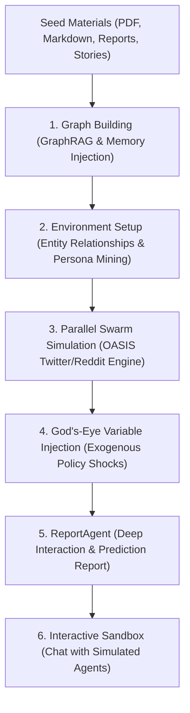

# MiroFish — Universal Swarm Intelligence & Prediction Engine

MiroFish is a next-generation AI prediction and swarm simulation engine incubated by Shanda Group and powered by CAMEL-AI's OASIS (Open Agent Social Interaction Simulations). By extracting seed information from real-world documents, policies, or narrative texts, it automatically constructs a high-fidelity digital world where thousands of intelligent agents with independent personalities and long-term memory interact.

## Architecture & Core Workflow



## Workstation Gateway Integration

MiroFish connects directly to the Unified AI Gateway (`http://127.0.0.1:8000/v1`) using standard OpenAI SDK endpoints, leveraging Smart 5-Tier fallback routing:

- **Local Gateway URL**: `http://127.0.0.1:8000/v1`
- **Model**: `auto` (routes to Claude Opus 4.6 / Llama 3.3 / DeepSeek R1 based on simulation complexity)
- **API Key**: `dummy-local-key`

### Configuration (`tools/MiroFish/.env`)

```env
# Unified Gateway Configuration
LLM_API_KEY=dummy-local-key
LLM_BASE_URL=http://127.0.0.1:8000/v1
LLM_MODEL_NAME=auto

# Memory & Service Configuration
ZEP_API_KEY=dummy-zep-key
SECRET_KEY=mirofish-workstation-local-key
FLASK_DEBUG=False
PORT=5001
```

## Quick Start & Execution

### 1. Backend Server (`uv run python run.py`)
Runs on port `5001`:
```bash
cd tools/MiroFish/backend
uv run python run.py
```

### 2. Frontend Web Dashboard
Runs on port `3000`:
```bash
cd tools/MiroFish/frontend
npm run dev
```

### 3. Running Headless Swarm Simulations
```bash
# Run OASIS Twitter simulation
cd tools/MiroFish/backend
uv run python scripts/run_twitter_simulation.py

# Run OASIS Reddit simulation
uv run python scripts/run_reddit_simulation.py

# Run Dual-Platform Parallel Simulation
uv run python scripts/run_parallel_simulation.py
```

## Key Use Cases

1. **Policy & Crisis Rehearsal**: Rehearse public reactions to breaking policy drafts, crisis PR, or market announcements before releasing them to the public.
2. **Financial & Signal Prediction**: Feed market indicators or economic reports to simulate collective investor sentiment and emergent trading dynamics.
3. **Counterfactual & Narrative Deduction**: Feed literary chapters or historical events to deduce unwritten endings and explore "what-if" branching timelines.
4. **Agent-to-Agent Social Media Sandbox**: Simulate viral cascade diffusion, algorithmic feed dynamics, and community formation on simulated social platforms.
